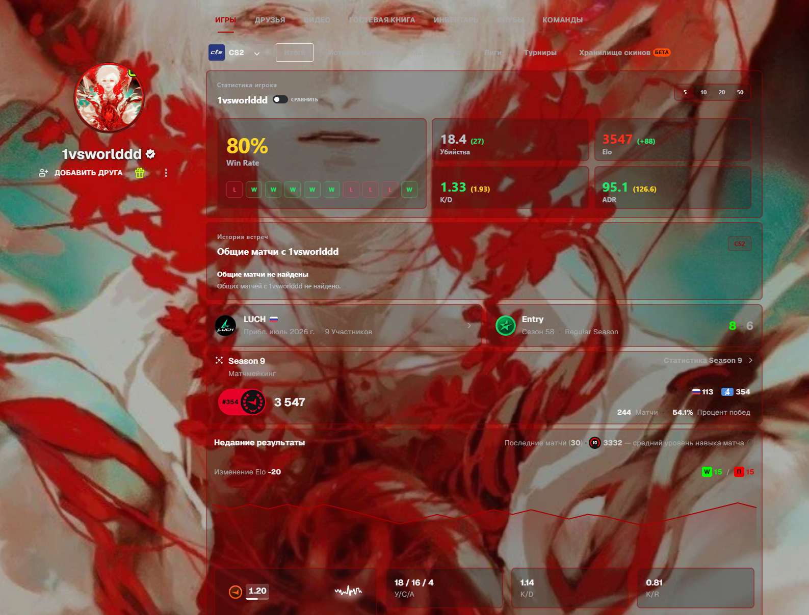
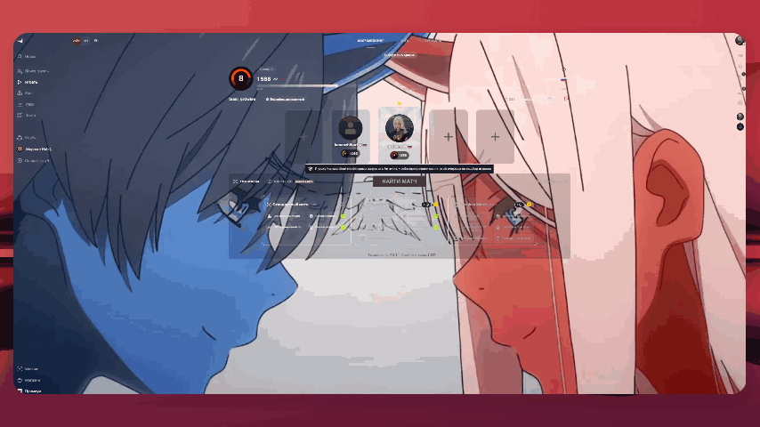

  

## FACEIT Absolute 2.6.0

**New background editor · Server auto-connect · Sound auto-send · Faster profiles**

A new background editor with 1080p photos, HEVC/AV1 videos, match-server auto-connect, sound auto-send to chat, clan-tag font size, unified lobby styling and fixes for repeated multi-second profile stalls. Read the [2.6.0 release notes](https://github.com/growlee/FACEIT-Absolute/releases/tag/v2.6.0) for changes, installation, and validation limits.

**[Chrome ZIP](https://github.com/growlee/FACEIT-Absolute/releases/download/v2.6.0/FACEIT-ABSOLUTE-2.6.0-chrome-github.zip) · [Firefox ZIP — unsigned](https://github.com/growlee/FACEIT-Absolute/releases/download/v2.6.0/FACEIT-ABSOLUTE-2.6.0-firefox-github.zip) · [Edge ZIP](https://github.com/growlee/FACEIT-Absolute/releases/download/v2.6.0/FACEIT-ABSOLUTE-2.6.0-edge-github.zip) · [Opera ZIP](https://github.com/growlee/FACEIT-Absolute/releases/download/v2.6.0/FACEIT-ABSOLUTE-2.6.0-opera-github.zip) · [SHA-256](https://github.com/growlee/FACEIT-Absolute/releases/download/v2.6.0/SHA256SUMS.txt)**

Version 2.6.0 is available on GitHub; store versions may differ. Chrome, Edge and Opera require Chromium 127 or newer. The Firefox ZIP is unsigned and intended for temporary testing; use Firefox Add-ons for permanent installation.

---

  <a href="https://github.com/growlee/FACEIT-Absolute#русский">Русский</a> · <strong>English</strong>

# FACEIT Absolute — custom FACEIT profile backgrounds

Want to change your FACEIT profile background and make the page your own? **FACEIT Absolute** is an independent browser extension with custom backgrounds, a background library, panel transparency, outlines, and additional FACEIT CS2 data.

**[Install in Chrome](https://faceit.eelworg.ru/r/l_yjJM01t2o4sTsH)** · **[Install in Firefox](https://faceit.eelworg.ru/r/PmGEU43eYuhbEofi)** · **[Download a ZIP for your browser](https://github.com/growlee/FACEIT-Absolute/releases/latest)**

[All installation methods](#installation) · [Background library](https://faceit.eelworg.ru/profile-library/) · [Project website](https://faceit.eelworg.ru/)

## Make FACEIT your own

| Feature                   | What you can do                                                               |
| ------------------------- | ----------------------------------------------------------------------------- |
| Custom profile background | Upload an image and customize the layout around it.                           |
| Background library        | Find a ready-made background, preview it, and apply it through the extension. |
| Transparency and outlines | Adjust panels, outline colors, and thickness to suit your background.         |
| Profile sections          | Hide sections you do not need.                                                |
| FACEIT CS2 statistics     | View additional player, match, and shared-match information.                  |

## Profile library

Open the [library](https://faceit.eelworg.ru/profile-library/), preview the styles, and choose a ready-made background for your profile.

## Another profile style

The images and animations show real profile customization examples. Available features depend on the extension version; some require a connected FACEIT account or Absolute Premium. Requirements are shown inside the extension.

## Installation

| Browser        | Recommended method                                                                                                                                                     |
| -------------- | ---------------------------------------------------------------------------------------------------------------------------------------------------------------------- |
| Google Chrome  | [Chrome Web Store](https://faceit.eelworg.ru/r/l_yjJM01t2o4sTsH)                                                                                                       |
| Firefox        | [Firefox Add-ons](https://faceit.eelworg.ru/r/PmGEU43eYuhbEofi)                                                                                                        |
| Microsoft Edge | Install from Chrome Web Store or use the Edge ZIP from [release 2.6.0](https://github.com/growlee/FACEIT-Absolute/releases/tag/v2.6.0).                                |
| Opera          | Install from Chrome Web Store if supported by your version, or use the Opera ZIP from [release 2.6.0](https://github.com/growlee/FACEIT-Absolute/releases/tag/v2.6.0). |

Install on a desktop computer. Browser-store versions may differ from GitHub releases.

### Manual installation in Chrome, Edge, or Opera

1. Open [release 2.6.0](https://github.com/growlee/FACEIT-Absolute/releases/tag/v2.6.0) and download the ZIP for Chrome, Edge, or Opera.
2. Extract the archive into a separate folder.
3. Open the extensions page: `chrome://extensions`, `edge://extensions`, or `opera://extensions`.
4. Enable developer mode and select **Load unpacked**.
5. Select the folder containing `manifest.json`.

For Firefox, use Firefox Add-ons. The Firefox ZIP in GitHub releases is unsigned and cannot be permanently installed in standard Firefox; it is provided for temporary testing.

## How to change your FACEIT background

1. Install FACEIT Absolute and open your own FACEIT profile.
2. Open the extension and connect your FACEIT account to use profile customization.
3. Choose a background from the [library](https://faceit.eelworg.ru/profile-library/) or upload an image through the profile customization settings.
4. Adjust transparency, outlines, and visible sections, then save your changes.

Check the preview when choosing a library background: applying it replaces your current background and its settings after confirmation. Background customization does not change player statistics or match results.

## Questions

**Can other players see my background?**

The extension changes how FACEIT pages appear in the browser. FACEIT Absolute is required to display this customization; a browser without the extension does not automatically receive these changes.

**Is this an official FACEIT extension?**

No. FACEIT Absolute is an independent project and is not affiliated with FACEIT. FACEIT and other names belong to their respective owners.

**How do I update a manual installation?**

Download the ZIP for the same browser, extract it into your existing extension folder, and click **Reload** on the extensions page. Keep the extension installed if you want to preserve its local settings.

**Where is the source code?**

This public repository contains documentation and release packages. Source code and server components are kept in a separate private repository.

## Support and privacy

Automatic error reports are enabled by default when no preference is set; an existing opt-out is preserved. You can disable them in Information. Reports contain limited diagnostic data and an installation identifier; see the [privacy policy](https://faceit.eelworg.ru/privacy).

- [Telegram support](https://t.me/faceitabsolutesupport_bot)
- [Report a bug or suggest an improvement](https://github.com/growlee/FACEIT-Absolute/issues)
- [Current privacy policy](https://faceit.eelworg.ru/privacy)
- [All releases and checksums](https://github.com/growlee/FACEIT-Absolute/releases)

Do not post passwords, tokens, cookies, or other private data in Issues. Contact support for private requests.
